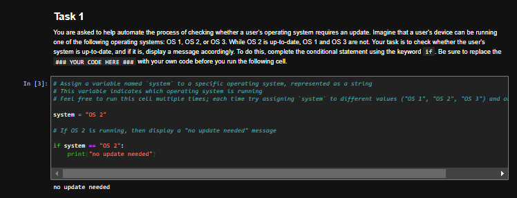
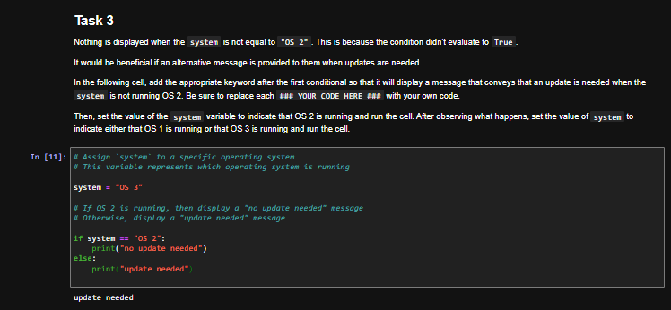
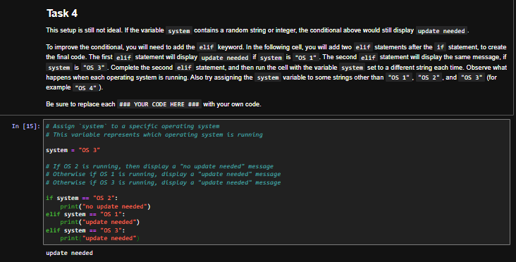
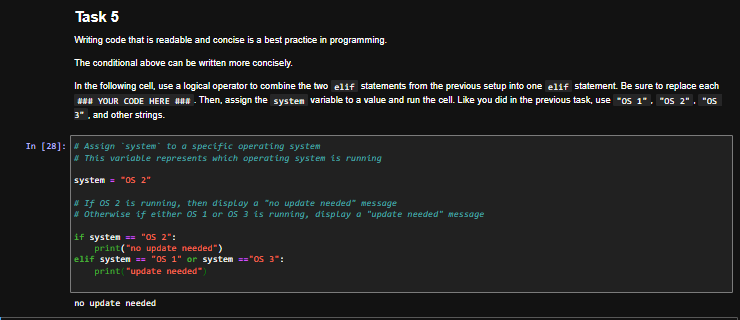
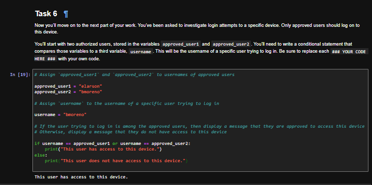
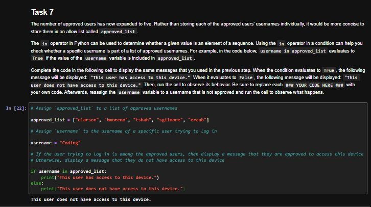
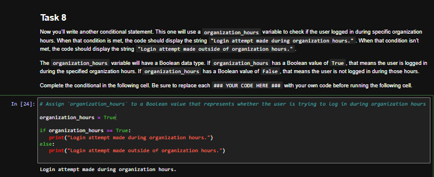
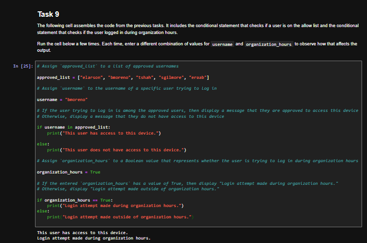
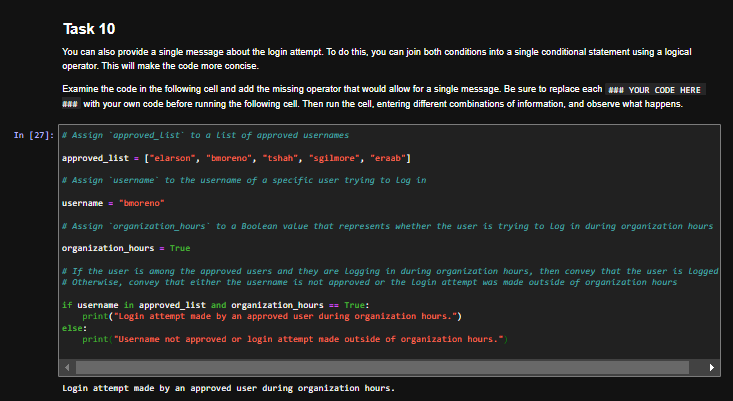

# Python Conditional Statements: OS Update and Login Access Checks

## Summary

In this lab from the Google Cybersecurity Certificate (Automate Cybersecurity Tasks with Python), I wrote Python conditional statements to automate two common security checks: whether a device's operating system needs an update, and whether a user trying to log in is approved and logging in during organization hours. The scenario and usernames are fictional and provided by the course.

## Tools Used

- Python 3
- Jupyter Notebook (course lab environment)

## Skills Demonstrated

- `if`, `elif`, and `else` statements
- Comparison operators (`==`)
- Logical operators (`or`, `and`)
- Membership checks with the `in` operator against an allow list
- Boolean variables in conditions

## Part 1: Operating System Update Check

Devices could run OS 1, OS 2, or OS 3. Only OS 2 is up to date.

**Task 1: `if` statement.** Display "no update needed" when the system is OS 2.

```python
system = "OS 2"

if system == "OS 2":
    print("no update needed")
```



**Task 3: `else` statement.** Add a message for every other system.

```python
if system == "OS 2":
    print("no update needed")
else:
    print("update needed")
```



**Task 4: `elif` statements.** Only flag OS 1 and OS 3, so a random value (like "OS 4") no longer prints "update needed".

```python
if system == "OS 2":
    print("no update needed")
elif system == "OS 1":
    print("update needed")
elif system == "OS 3":
    print("update needed")
```



**Task 5: combining with `or`.** Combine the two `elif` branches into one. Each side of `or` needs its own full comparison; `system == "OS 1" or "OS 3"` would always evaluate to True, because a non-empty string is truthy.

```python
if system == "OS 2":
    print("no update needed")
elif system == "OS 1" or system == "OS 3":
    print("update needed")
```



## Part 2: Login Access Checks

**Task 6: two approved users.** Compare the username to two approved users.

```python
approved_user1 = "elarson"
approved_user2 = "bmoreno"
username = "bmoreno"

if username == approved_user1 or username == approved_user2:
    print("This user has access to this device.")
else:
    print("This user does not have access to this device.")
```



**Task 7: allow list with `in`.** With five approved users, store them in a list and check membership. Tested with an unapproved username ("Coding"), which is correctly denied.

```python
approved_list = ["elarson", "bmoreno", "tshah", "sgilmore", "eraab"]

if username in approved_list:
    print("This user has access to this device.")
else:
    print("This user does not have access to this device.")
```



**Task 8: organization hours.** Use a Boolean to check whether the login happened during organization hours.

```python
organization_hours = True

if organization_hours == True:
    print("Login attempt made during organization hours.")
else:
    print("Login attempt made outside of organization hours.")
```



**Task 9: both checks separately.** Run the allow list check and the organization hours check one after the other, testing different combinations of `username` and `organization_hours`.



**Task 10: one condition with `and`.** Join both checks into a single condition so the user gets one message. Access is only confirmed when the user is approved **and** logging in during organization hours.

```python
if username in approved_list and organization_hours == True:
    print("Login attempt made by an approved user during organization hours.")
else:
    print("Username not approved or login attempt made outside of organization hours.")
```



## Takeaways

- Conditionals let a script make the same access and patch decisions an analyst would, consistently and at scale.
- An allow list checked with `in` scales far better than comparing against individual variables.
- `elif` and `else` behave differently: `elif` needs its own condition, while `else` catches everything left over, so careful branching prevents unexpected values from being mislabeled.
- Logical operators need a complete comparison on each side to avoid conditions that are always True.
